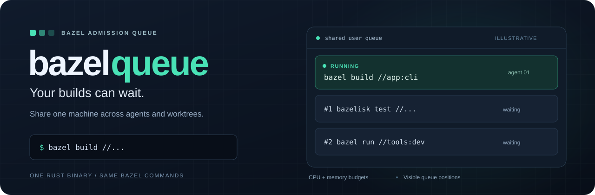
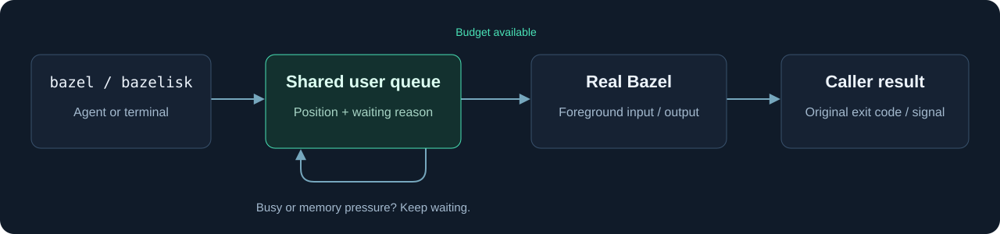

<p align="center">
  
</p>

<p align="center">
  <a href="https://github.com/bitomule/bazelqueue/actions/workflows/ci.yml"></a>
  <a href="https://github.com/bitomule/bazelqueue/releases"></a>
  <a href="https://github.com/bitomule/homebrew-tap/blob/master/Formula/bazelqueue.rb"></a>
  
</p>

# bazelqueue

**Keep calling `bazel`. Let the queue decide when it can start.**

Calls from agents and terminals share one queue per user. When CPU or memory
capacity is occupied, the caller sees its position and waits. Once admitted,
the real Bazel command runs with its arguments, terminal, stdin and stdout.
Its exit code or signal goes back to the caller.

One Rust executable, approximately **5 MiB**, with SQLite linked in. End users
need Bazel/Bazelisk; Rust and Python are development dependencies.

[Install](#install) · [Agents](#using-it-from-an-agent) · [Queue controls](#queue-controls) · [Configure](#configure) · [Compatibility](#compatibility) · [Documentation](#documentation)

## Install

```sh
brew install bitomule/tap/bazelqueue
bazelqueue setup
```

Open a new terminal and check that both names resolve to `~/.local/bin`:

```sh
command -v bazel bazelisk
```

Then use the commands already in your workflow:

```sh
bazel build //...
bazelisk test //... --test_output=errors
bazel run //tools:dev -- --port 8080
```

If a fresh login shell still selects Homebrew's backend first, run
`bazelqueue setup` from that shell to install its reversible PATH integration.

<details>
<summary>Custom backend or installation from source</summary>

```sh
make release
./target/release/bazelqueue setup --backend /absolute/path/to/real/bazelisk
```

Use an absolute backend path that does not resolve back to a queue shim.

</details>

## What waiting looks like

An illustrative call from an agent while another workspace occupies the budget:

```text
$ bazelisk test //app:all 2> build.log
bazelqueue: queued 4242-1792672532967253000 at position 2 (waiting: resource capacity)
bazelqueue: this call exits when the build ends and then prints a `bazelqueue: finished` summary with each failure and its log; wait for it instead of polling status, pgrep or the log
bazelqueue: started 4242-1792672532967253000 after 3m12s in queue
INFO: …Bazel's own output…
bazelqueue: finished 4242-1792672532967253000 exit=3 TESTS_FAILED queued=3m12s ran=1m05s failed=1
bazelqueue: FAILED //app:unit_tests FAILED log=/…/testlogs/app/unit_tests/test.log
bazelqueue: summary ~/.local/state/bazelqueue/runs/4242-1792672532967253000.json
```

Queue notices and the summary go to **stderr**, so stdout remains available for
scripts and pipes. The calling agent stays attached to the command while it
waits. In a terminal, every position change is shown as it happens.



| Situation | Queue behavior |
|---|---|
| Several agents use different worktrees | CPU and memory reservations determine which calls fit. Same-server calls keep FIFO order. |
| Memory pressure rises | Warning keeps full capacity. Critical pressure or active swap thrashing admits one smaller build if real memory headroom permits; the next safe sample restores full admission. |
| The caller disappears | Its owned backend is cancelled. Capacity is retained until completion or verified recovery. |
| The coordinator restarts | Guardians reconnect without submitting the command a second time. |
| `bazel run` finishes compiling | The target runs through Bazel's generated script. Compilation capacity is released; the target's process footprint remains tracked. |

Running builds never lose their reservation because a timer expired. Uncertain
native work stays quarantined while recovery verifies its processes and server.
Idle or terminated work releases its reservation and gets a final exit code and
reason. A recorded orphan server that no longer answers its liveness RPC is
stopped only after identity and ownership checks and a stopped-process check
proves it has no children. A server with children is resumed and keeps its
reservation. Busy servers keep their reservation. Recovery never
retries the build. [Architecture and recovery](docs/architecture.md).

## Using it from an agent

Waiting builds and long logs are what make an agent expensive: every poll, `tail`
or `grep` re-reads the whole conversation. bazelqueue is built so one call is
enough to learn the result, and it tells the agent so itself: when stderr is not
a terminal, the first notice of a build is followed by one line saying the call
exits when the build ends and prints a summary. No project instructions are
needed for an agent to read it at the moment it would start polling.

- **Run Bazel in the background and wait for the process to exit.** Do not poll
  `bazelqueue status`, `pgrep` or the log in a loop. While queued, a call prints
  one line with its request ID; it prints nothing more until the build starts.
- **Read only the summary.** The last lines of every build start with
  `bazelqueue: finished` and `bazelqueue: FAILED`: exit code, queue wait, run
  time, and each failed test or target with its `test.log` path. Open a test log
  only for a failure you need to fix; do not read the whole build output.
- **Lost track of a build?** `bazelqueue wait` blocks until the newest build of
  the current workspace ends, prints the same summary and exits with its exit
  code. `bazelqueue wait ID` waits for a specific request; `--json` prints the
  summary as JSON.
- **Want a file?** Set `BAZELQUEUE_SUMMARY=/path/result.json` for a JSON copy of
  the summary, or read `~/.local/state/bazelqueue/runs/ID.json`.

Failed targets and test logs come from Bazel's Build Event Protocol, which
bazelqueue requests for managed `build`, `test`, `run` and `coverage` calls.
Where it cannot (unsupported Bazel versions, `tools/bazel` wrappers, a bazelrc
that sets its own `--build_event_json_file`), the summary still has the exit
code and timings and says `failed=unreported`.

If you also want it in a project's `AGENTS.md` or `CLAUDE.md`:

```markdown
Bazel calls go through bazelqueue and may wait in a queue. Run them in the
background and wait for the process to exit; never poll `bazelqueue status`,
`pgrep` or the log. When it ends, read only the lines starting with
`bazelqueue: finished` / `bazelqueue: FAILED` (for example `grep '^bazelqueue:'
build.log`) and open a listed test log only for a failure you are fixing. If you
lost the process, `bazelqueue wait` blocks until the workspace's newest build
ends and exits with its status.
```

## Queue controls

```sh
bazelqueue watch             # Follow the queue
bazelqueue status --json     # Inspect it from a script or agent
```

| Command | Purpose |
|---|---|
| `bazelqueue status` | Show current requests and waiting reasons. |
| `bazelqueue wait [REQUEST_ID]` | Block until a request ends; print its summary and exit with its status. |
| `bazelqueue cancel REQUEST_ID` | Cancel a queued or owned running request. |
| `bazelqueue drain` | Pause new admissions while current work finishes. |
| `bazelqueue resume` | Reopen admission. |
| `bazelqueue doctor` | Check the backend, telemetry and recovery state. |
| `bazelqueue config show` | Print the effective configuration. |
| `bazelqueue exec -- /absolute/backend ARGS...` | Queue a backend explicitly without PATH interception. |

`status` also shows the ten most recent failed requests, with their exit code
and reason. `status --json` includes those details in the retained job records.
Recovered requests with no known result end with exit 125; `bazelqueue wait ID`
reports that failure even if the guardian could not save a summary. Explicit
disk-full evidence is shown as such; an environmental exit code alone is not
treated as proof that the disk was full.

<details>
<summary>Upgrades and removal</summary>

`brew upgrade` only replaces the Homebrew binary; the running coordinator and
the shims keep using the previous retained executable. `bazelqueue setup` is the
upgrade step, and it does not wait for the queue to empty:

```sh
brew upgrade bazelqueue
bazelqueue setup
```

Setup activates the new executable and replaces an older coordinator with one
started from it before resuming the queue. Queued and running requests stay
where they are: their guardians reconnect to the new coordinator, which already
holds the coordinator lock when the old one exits, so a guardian of an older
release cannot bring its own coordinator back. `bazelqueue status` and
`bazelqueue doctor` warn while the running coordinator is a different version
than the command you run.

Each caller uses a retained helper image, so removing an old Homebrew keg does
not remove the executable needed by an active guardian.

Restore the original user shims before removing the formula:

```sh
bazelqueue uninstall
brew uninstall bazelqueue
```

Uninstall checks ownership and refuses active requests. It preserves independent
edits to shell profiles. [Installation lifecycle](docs/installation.md).

</details>

## Configure

Private state and configuration live in `~/.local/state/bazelqueue`.

```sh
bazelqueue config show
${EDITOR:-vi} ~/.local/state/bazelqueue/config.toml
```

| Setting | Controls |
|---|---|
| `max_builds` | Target concurrency for large managed builds. Default: **2** (bounded by machine size); smaller estimated runs can share remaining capacity. |
| `cpu_capacity` | The total CPU token budget shared by admitted builds. |
| `memory_capacity_mib` | The total estimated invocation memory budget. |
| `jobs` | The cap on actions Bazel keeps in flight, cache checks included. Default: **64**; the reserved CPUs, not this, limit what runs locally. |
| `worker_instances` | Worker and multiplex-worker instance caps. |
| `memory_safety_mib` | Free-memory margin, at least 5% of RAM. Default: **1024 MiB**. |
| `swap_thrashing_mib_per_min` | Threshold that both swap-in and swap-out rates must exceed to reduce admission. Default: **64 MiB/min** each. |

A lone supported build can receive the wide profile. Concurrent managed builds
use smaller reservations; their budgets remain fixed once execution starts.
Proven stricter direct numeric caller limits are preserved.
New configurations leave one CPU free and reserve total RAM minus the safety
margin. Existing configuration values are preserved on upgrade; set
`max_builds = 2` to share a previously serial configuration.

**Cache checks do not wait for CPUs.** Bazel counts every action against
`--jobs`, including the ones it only looks up and downloads from the disk or
remote cache. bazelqueue therefore passes `--jobs` from `jobs` (64 by default)
and limits local work with `--local_resources=cpu=N,memory=M` from the
reservation. Tests are not capped at two: `--local_test_jobs=0` lets each test
reserve its CPUs from the same budget, one by default or N with a `cpu:N` tag.
A `--local_test_jobs` given on the command line is kept, up to the reserved
CPUs.

**Repeated builds and tests are sized from their last runs.** When a managed
build or test ends, bazelqueue records how many cores its Bazel server, workers,
actions and tests kept busy on average. The next run of the same command,
targets and flags in the same repository (any of its worktrees) reserves 1.25
times the busiest of the last three runs, at least 2 CPUs, with memory in the
same proportion: a cached test run on an 8 CPU / 9 GiB budget asks for 2 CPU and
2304 MiB. Flags that pick tests or shape their output rather than what gets
built (`--test_filter`, `--test_arg`, `--test_output`, `--test_env`,
`--runs_per_test`, `--[no]cache_test_results`, `--build_event_json_file`,
`--execution_log_json_file`) do not count, so runs that only change them share
one history. A run with no history of its own reserves 1.25 times the median of
the latest nine runs of the same command in the same repository. Estimated runs
share the machine by CPU and memory instead of taking a `max_builds` slot, so
several small test runs execute side by side. A saturated run requests more next
time, but a full-machine estimate is divided when other lanes are waiting.
A run in a repository with no history of its command receives the same fair
share. History lives in
`estimates.json` in the state directory.

**Warning is not a reason to slow a build down.** Under native warning pressure,
sixteen fresh Clang compilations took **16.14 / 16.45 s** with 8 CPU / 9 GiB,
versus **25.31 / 24.86 s** with 2 CPU / 2304 MiB. These are workload-specific
measurements, not a throughput guarantee. [Method and admission research](docs/admission-measurements.md).

Memory values are estimates, not hard OS quotas. Each admission checks real
available memory after the safety margin and growth still promised to active
reservations. Critical pressure or bidirectional swap thrashing reduces new
managed work to one smaller build; opaque invocations wait. A high CPU load
also holds new admission. Recovery takes effect on the next sample, even under
warning. Existing grants remain unchanged. The legacy `pressure_recovery_samples`
setting is accepted but no longer delays recovery.

`bazelqueue status` and `status --json` show hourly utilization for the latest
24 hours: observed time, time with a build running, reserved CPU and memory, and
actual host CPU use. Parallel builds count once in busy time. Percentages use
observed time; partial hours and restart/sampling gaps are not presented as full
hours of idle time. Reserved capacity includes preparation and quarantine; host
CPU includes other applications. Metrics begin with this version and survive
coordinator restarts.

| Environment variable | Use |
|---|---|
| `BAZELQUEUE_HOME` | Select an isolated state namespace. |
| `BAZELQUEUE_PROGRESS=quiet` | Suppress queue notices (the end-of-run summary stays). |
| `BAZELQUEUE_PROGRESS=verbose` | Print every position change even when stderr is not a terminal. |
| `BAZELQUEUE_SUMMARY` | Also write the end-of-run summary JSON to this path. |

## Compatibility

| Area | Support |
|---|---|
| Distribution | macOS **Apple Silicon**, via Homebrew. |
| Managed resource policy and native recovery | Validated on **Bazel 8.4.2 and 9.2.0**. |
| Unsupported versions, opaque wrappers and complex overrides | Original arguments under exclusive compatibility admission. |
| `bazel run --script_path` / `--norun` and opaque run modes | Preserve native behavior. |
| Process scope | Calls through the activated PATH or explicit `exec`, for the same user. |

Absolute calls to unmanaged binaries and other users' processes bypass PATH
interception. The queue stores metadata, **not full argv, environment,
credentials or build output**. Existing project wrappers are preserved; managed
nested calls are rejected to avoid waiting behind their own parent.

## Tested against actual process failures

The current validation suite covers these contracts. Executed native results
and any limitations are recorded in the validation evidence below.

| Layer | Checks | Evidence covered |
|---|---:|---|
| Unit | 87 | Scheduling, injected recovery/liveness, resource samples, utilization, framing, configuration and persistent drain state. |
| Process E2E | 31 | FIFO/rank, warning parallelism, pressure/swap recovery, cancellation, restart, raw argument bytes, retained executables and failure diagnostics. |
| Installation | 17 | Interrupted setup, rollback, upgrades, original backups and shell activation. |
| Interactive PTY | 3 | Terminal input, Ctrl-C and Ctrl-Z/fg in a real shell. |
| Native Bazel | 12 per version | Parallel held actions under warning, paused guardians, interrupted retirement, orphan recovery and run handoff; matrix: 8.4.2 and 9.2.0. |

We deleted the original frontend executable during a live build and restarted
the coordinator; retained ownership and native run handoff still completed.
An unread stderr pipe also broke a recovery test. Its noisy-output ablation
reproduced the blocked client, and the consumed-output version passed.
[Read the validation evidence](docs/validation.md).

## Documentation

| Guide | Read it for |
|---|---|
| [Installation](docs/installation.md) | Migration, PATH integration and reversible setup. |
| [Architecture](docs/architecture.md) | Reservations, ownership, server lanes and recovery. |
| [Validation](docs/validation.md) | Fault tests and measured performance. |
| [Releases](docs/release.md) | Immutable artifacts, Homebrew and Actions credentials. |

<details>
<summary>Development commands</summary>

```sh
make all
BAZELQUEUE_TEST_BAZEL=/absolute/path/to/bazel make contract
make release
musts validate
```

Runtime code is Rust. Python is used for development PTY tests and opt-in
calibration. Tests isolate HOME, state and Bazel workspaces; ordinary suites
leave the user's live installation untouched.

</details>

Licensed under [MIT](LICENSE-MIT) or [Apache 2.0](LICENSE-APACHE).
