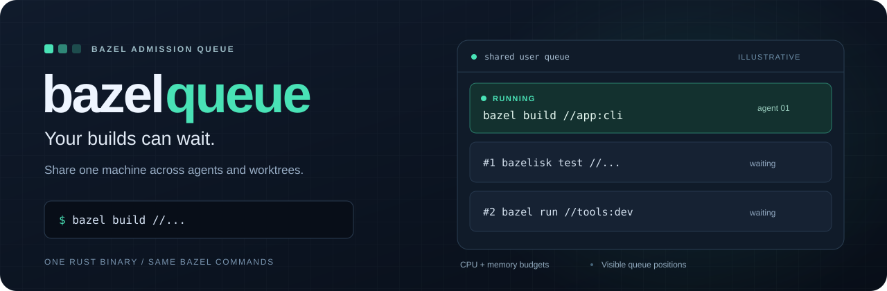
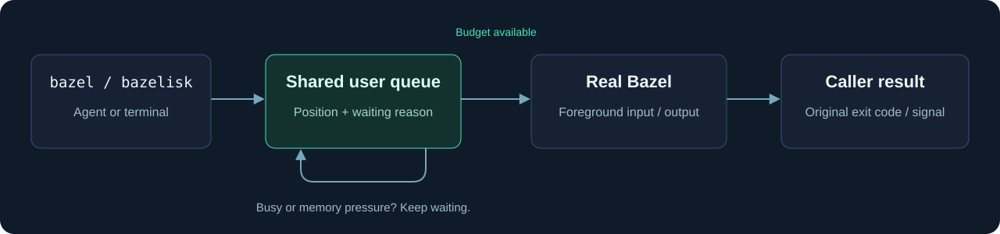

<p align="center">
  
</p>

<p align="center">
  <a href="https://github.com/bitomule/bazelqueue/actions/workflows/ci.yml"></a>
  <a href="https://github.com/bitomule/bazelqueue/releases"></a>
  <a href="https://github.com/bitomule/homebrew-tap/blob/master/Formula/bazelqueue.rb"></a>
  
</p>

# bazelqueue

**Keep calling `bazel`. Let the queue decide when it can start.**

Calls from agents and terminals share one queue per user. When CPU or memory
capacity is occupied, the caller sees its position and waits. Once admitted,
the real Bazel command runs with its arguments, terminal, stdin and stdout.
Its exit code or signal goes back to the caller.

One Rust executable, approximately **5 MiB**, with SQLite linked in. End users
need Bazel/Bazelisk; Rust and Python are development dependencies.

[Install](#install) · [Agents](#using-it-from-an-agent) · [Queue controls](#queue-controls) · [Configure](#configure) · [Compatibility](#compatibility) · [Documentation](#documentation)

## Install

```sh
brew install bitomule/tap/bazelqueue
bazelqueue setup
```

Open a new terminal and check that both names resolve to `~/.local/bin`:

```sh
command -v bazel bazelisk
```

Then use the commands already in your workflow:

```sh
bazel build //...
bazelisk test //... --test_output=errors
bazel run //tools:dev -- --port 8080
```

If a fresh login shell still selects Homebrew's backend first, run
`bazelqueue setup` from that shell to install its reversible PATH integration.

<details>
<summary>Custom backend or installation from source</summary>

```sh
make release
./target/release/bazelqueue setup --backend /absolute/path/to/real/bazelisk
```

Use an absolute backend path that does not resolve back to a queue shim.

</details>

## What waiting looks like

An illustrative call from an agent while another workspace occupies the budget:

```text
$ bazelisk test //app:all 2> build.log
bazelqueue: queued 4242-1792672532967253000 at position 2 (waiting: resource capacity)
bazelqueue: this call exits when the build ends and then prints a `bazelqueue: finished` summary with each failure and its log; wait for it instead of polling status, pgrep or the log
bazelqueue: started 4242-1792672532967253000 after 3m12s in queue
INFO: …Bazel's own output…
bazelqueue: finished 4242-1792672532967253000 exit=3 TESTS_FAILED queued=3m12s ran=1m05s failed=1
bazelqueue: FAILED //app:unit_tests FAILED log=/…/testlogs/app/unit_tests/test.log
bazelqueue: summary ~/.local/state/bazelqueue/runs/4242-1792672532967253000.json
```

Queue notices and the summary go to **stderr**, so stdout remains available for
scripts and pipes. The calling agent stays attached to the command while it
waits. In a terminal, every position change is shown as it happens.



| Situation | Queue behavior |
|---|---|
| Several agents use different worktrees | CPU and memory reservations determine which calls fit. A call that fits may pass one that does not, at most four times; same-server calls of the same priority keep FIFO order. |
| A build is more urgent than the queue ahead of it | Give it `BAZELQUEUE_PRIORITY=high` (or `bazelqueue exec --priority high -- ...`). In the queue, higher priority goes first and arrival order breaks ties; it takes the next free slot but never cuts a running build, and low disk, swap and CPU limits apply to it like to any other call. `low` waits behind `normal` and `high`, with no aging. |
| A build or test has nothing to rebuild | Bazel's own up-to-date check runs in a small fast-lane slot; if it passes, the call starts at once instead of waiting behind other builds. |
| The machine runs short | High CPU load halves new work. Critical pressure, macOS writing to swap or low disk space admit one smaller build, only with nothing else of the queue running. A disk almost full or a sensor without data hold new builds. Running ones keep their reservation, and the next safe sample restores full admission. |
| The caller disappears | Its owned backend is cancelled. Capacity is retained until completion or verified recovery. |
| A build stops progressing | With no Bazel events, output or CPU for `stall_minutes`, the call exits with 124 (`TIMEOUT`) and its hung server is killed. A slow test keeps running: Bazel's progress lines count as output. |
| The coordinator restarts | Guardians reconnect without submitting the command a second time. |
| `bazel run` finishes compiling | The target runs through Bazel's generated script. Compilation capacity is released; the target's process footprint remains tracked. |

Running builds never lose their reservation because a timer expired. Uncertain
native work stays quarantined while recovery verifies its processes and server.
Idle or terminated work releases its reservation and gets a final exit code and
reason. A recorded orphan server that no longer answers its liveness RPC is
stopped only after identity and ownership checks and a stopped-process check
proves it has no children. A server with children is resumed and keeps its
reservation. Busy servers keep their reservation. Recovery never
retries the build. A stalled server is the one exception to the child check: its
silence, flat CPU and lack of clients are proof, so the server and its process
tree are killed even if its output base was deleted, and the reservation ends
when their exit is observed. [Architecture and recovery](docs/architecture.md).

## Using it from an agent

Waiting builds and long logs are what make an agent expensive: every poll, `tail`
or `grep` re-reads the whole conversation. bazelqueue is built so one call is
enough to learn the result, and it tells the agent so itself: when stderr is not
a terminal, the first notice of a build is followed by one line saying the call
exits when the build ends and prints a summary. No project instructions are
needed for an agent to read it at the moment it would start polling.

- **Run Bazel in the background and wait for the process to exit.** Do not poll
  `bazelqueue status`, `pgrep` or the log in a loop. While queued, a call prints
  one line with its request ID; it prints nothing more until the build starts.
- **Read only the summary.** The last lines of every build start with
  `bazelqueue: finished` and `bazelqueue: FAILED`: exit code, queue wait, run
  time, and each failed test or target with its `test.log` path. Open a test log
  only for a failure you need to fix; do not read the whole build output.
- **Exit 124 with `TIMEOUT` means the build stopped progressing,** not that it
  failed: bazelqueue cut it and killed its Bazel server. The summary's `stall`
  field holds the evidence. Run it again; the next call starts a fresh server.
- **Lost track of a build?** `bazelqueue wait` blocks until the newest build of
  the current workspace ends, prints the same summary and exits with its exit
  code. `bazelqueue wait ID` waits for a specific request; `--json` prints the
  summary as JSON.
- **Unblocking something urgent?** Launch the build with
  `BAZELQUEUE_PRIORITY=high bazel test ...`. A tool that already knows how urgent
  its work is (a task runner, for example) only needs to map that to
  `high`/`normal`/`low` in the environment of the build it starts; bazelqueue
  knows nothing about the tool.
- **Want a file?** Set `BAZELQUEUE_SUMMARY=/path/result.json` for a JSON copy of
  the summary, or read `~/.local/state/bazelqueue/runs/ID.json`.

Failed targets and test logs come from Bazel's Build Event Protocol, which
bazelqueue requests for managed `build`, `test`, `run` and `coverage` calls.
Where it cannot (unsupported Bazel versions, `tools/bazel` wrappers, a bazelrc
that sets its own `--build_event_json_file`), the summary still has the exit
code and timings and says `failed=unreported`.

If you also want it in a project's `AGENTS.md` or `CLAUDE.md`:

```markdown
Bazel calls go through bazelqueue and may wait in a queue. Run them in the
background and wait for the process to exit; never poll `bazelqueue status`,
`pgrep` or the log. When it ends, read only the lines starting with
`bazelqueue: finished` / `bazelqueue: FAILED` (for example `grep '^bazelqueue:'
build.log`) and open a listed test log only for a failure you are fixing. If you
lost the process, `bazelqueue wait` blocks until the workspace's newest build
ends and exits with its status.
```

## Queue controls

```sh
bazelqueue watch             # Follow the queue
bazelqueue status --json     # Inspect it from a script or agent
```

| Command | Purpose |
|---|---|
| `bazelqueue status` | Show current requests and waiting reasons. |
| `bazelqueue wait [REQUEST_ID]` | Block until a request ends; print its summary and exit with its status. |
| `bazelqueue cancel REQUEST_ID` | Cancel a queued or owned running request. |
| `bazelqueue drain` | Pause new admissions while current work finishes. |
| `bazelqueue resume` | Reopen admission. |
| `bazelqueue doctor` | Check the backend, telemetry and recovery state. |
| `bazelqueue config show` | Print the effective configuration. |
| `bazelqueue exec [--priority high\|normal\|low] -- /absolute/backend ARGS...` | Queue a backend explicitly without PATH interception. |

`status` marks requests that are not `normal` priority with `priority=high` or
`priority=low`; `status --json` has it in `jobs[].request.priority`.

`status` also shows the ten most recent failed requests, with their exit code
and reason. `status --json` includes those details in the retained job records.
Each queued job there also carries `queued_at_ms` (Unix milliseconds when it
entered the queue) and `wait` with its `position`, a typed `kind` and the
`reason` text for people. `kind` is one of `draining`, `maintenance`,
`legacy_draining`, `memory_held`, `reduced_admission`, `workspace_busy`,
`waiting_for_memory` or `capacity`. All of these fields are additive.
Recovered requests with no known result end with exit 125; `bazelqueue wait ID`
reports that failure even if the guardian could not save a summary. Explicit
disk-full evidence is shown as such; an environmental exit code alone is not
treated as proof that the disk was full.

<details>
<summary>Upgrades and removal</summary>

`brew upgrade` only replaces the Homebrew binary; the running coordinator and
the shims keep using the previous retained executable. `bazelqueue setup` is the
upgrade step, and it does not wait for the queue to empty:

```sh
brew upgrade bazelqueue
bazelqueue setup
```

Setup activates the new executable and replaces an older coordinator with one
started from it before resuming the queue. Queued and running requests stay
where they are: their guardians reconnect to the new coordinator, which already
holds the coordinator lock when the old one exits, so a guardian of an older
release cannot bring its own coordinator back. `bazelqueue status` and
`bazelqueue doctor` warn while the running coordinator is a different version
than the command you run.

Each caller uses a retained helper image, so removing an old Homebrew keg does
not remove the executable needed by an active guardian.

Restore the original user shims before removing the formula:

```sh
bazelqueue uninstall
brew uninstall bazelqueue
```

Uninstall checks ownership and refuses active requests. It preserves independent
edits to shell profiles. [Installation lifecycle](docs/installation.md).

</details>

## Configure

Private state and configuration live in `~/.local/state/bazelqueue`.

```sh
bazelqueue config show
${EDITOR:-vi} ~/.local/state/bazelqueue/config.toml
```

| Setting | Controls |
|---|---|
| `max_builds` | Target concurrency for large managed builds. Default: **2** (bounded by machine size); smaller estimated runs can share remaining capacity. |
| `cpu_capacity` | The total CPU token budget shared by admitted builds. |
| `memory_capacity_mib` | The total estimated invocation memory budget. |
| `jobs` | The cap on actions Bazel keeps in flight, cache checks included. Default: **64**; the reserved CPUs, not this, limit what runs locally. |
| `worker_instances` | Worker and multiplex-worker instance caps. |
| `memory_safety_mib` | Free-memory margin, at least 5% of RAM. Default: **1024 MiB**. |
| `swap_thrashing_mib_per_min` | New builds wait while swap-out or swap growth, over the last 60 seconds, exceeds this rate. Default: **64 MiB/min**. |
| `disk_safety_mib` | Below this free space on the output base of a build that has one, one build runs at a time; below half of it, new builds wait. The queue state only needs 1024 MiB. Default: **10240 MiB**. |
| `fast_lane_slots` | Up-to-date checks, and the runs they admit, that may proceed outside the build capacity at once. Default: **2**; `0` turns the fast lane off. |
| `stall_minutes` | Minutes without Bazel events, `command.log` output or CPU before a job is cut as a time failure. Default: **10**; `0` turns detection off. macOS only. Bazel 9 writes no `command.log` by default, so a job there with child processes and a connected client is not cut. |

A lone supported build can receive the wide profile. Concurrent managed builds
use smaller reservations; their budgets remain fixed once execution starts.
Proven stricter direct numeric caller limits are preserved.
New configurations leave one CPU free and reserve total RAM minus the safety
margin. Existing configuration values are preserved on upgrade; set
`max_builds = 2` to share a previously serial configuration.

**Cache checks do not wait for CPUs.** Bazel counts every action against
`--jobs`, including the ones it only looks up and downloads from the disk or
remote cache. bazelqueue therefore passes `--jobs` from `jobs` (64 by default)
and limits local work with `--local_resources=cpu=N,memory=M` from the
reservation. Tests are not capped at two: `--local_test_jobs=0` lets each test
reserve its CPUs from the same budget, one by default or N with a `cpu:N` tag.
A `--local_test_jobs` given on the command line is kept, up to the reserved
CPUs.

**`--jobs=1` does not request a 1 CPU reservation.** It limits Bazel to one
action in flight, including cache work. That action can use several CPUs
(for example, a test tagged `cpu:4`) and substantial memory, and the server and
workers also consume resources. The queue therefore sizes CPU and memory
separately from `--jobs`; `--jobs 1`, `-j=1` and `-j 1` have the same meaning.
The direct limit still reaches Bazel as 1. `--local_test_jobs=1` limits local
test concurrency, not the build's reservation either.

For example, with 6 CPU / 8192 MiB and `max_builds = 1`, a test with no history
can request the whole budget despite `--jobs=1`. Another running request of
1 CPU / 1536 MiB prevents it from starting under that serial configuration.
To allow large managed calls to share, edit the configuration shown above and
set `max_builds = 2`. Before execution, a queued managed call can then receive
the remaining 5 CPU / 6656 MiB, subject to measured memory and pressure checks.
This is a concurrency setting for the whole queue, not a per-call CPU request.
An already running build keeps its grant until it finishes.

For smaller reservations of repeated calls, let the queue learn their measured
usage as described below: on that 6 CPU / 8192 MiB budget, a low-use history
produces 2 CPU / 2730 MiB and can share even with `max_builds = 1`.
There is currently no per-invocation flag to request exactly 1 CPU / 1536 MiB.
Lowering `cpu_capacity` and `memory_capacity_mib` lowers the whole queue's
budget, not just one call. Do not use another state directory or a direct
backend invocation to bypass accounting. Unsupported versions, wrappers and
opaque resource overrides retain exclusive compatibility admission; neither
`--jobs=1` nor `max_builds = 2` makes those calls share.

**Repeated builds and tests are sized from their last runs.** When a managed
build or test ends, bazelqueue records how many cores its Bazel server, workers,
actions and tests kept busy on average. The next run of the same command,
targets and flags in the same repository (any of its worktrees) reserves 1.25
times the busiest of the last three runs, at least 2 CPUs, with memory in the
same proportion: a cached test run on an 8 CPU / 9 GiB budget asks for 2 CPU and
2304 MiB. Flags that pick tests or shape their output rather than what gets
built (`--test_filter`, `--test_arg`, `--test_output`, `--test_env`,
`--runs_per_test`, `--[no]cache_test_results`, `--build_event_json_file`,
`--execution_log_json_file`) do not count, so runs that only change them share
one history. A run with no history of its own reserves 1.25 times the median of
the latest nine runs of the same command in the same repository. Estimated runs
share the machine by CPU and memory instead of taking a `max_builds` slot, so
several small test runs execute side by side. A saturated run requests more next
time, but a full-machine estimate is divided when other lanes are waiting.
A run in a repository with no history of its command receives the same fair
share. History lives in
`estimates.json` in the state directory.

**Builds with nothing to rebuild skip the queue.** A queued managed `build` or
`test` in a workspace where Bazel already built successfully first asks Bazel
itself, with `--check_up_to_date` or `--check_tests_up_to_date`, whether it would
execute anything, unless earlier work waits in the same workspace. The check
runs with the caller's arguments in a fast-lane slot
of the worker count in CPUs and 1536 MiB, outside the build capacity but within
real memory headroom, and never under critical pressure. Only exit code 0 counts:
the call then starts at once in that slot and prints `bazelqueue: started ID at
once: Bazel reports nothing to rebuild`. Tests Bazel never caches still run, at
the slot's CPUs. Any other result, a busy server or a 30 second timeout keeps the
call at its queue position, already prepared. Bazel's check only trusts the
workspace's own action cache: results available only in a remote or disk cache
still wait for a reservation. [Measurements](docs/admission-measurements.md#fast-lane-measurement-5-november-2026).

**Admission follows what the machine really has free.** Free memory is what macOS
can hand over without compressing or swapping: free pages, file cache and
purgeable pages. Bazel servers, Docker and other apps count because they occupy
it. Each admission checks that figure after the safety margin and growth still
promised to active reservations.

| Signal | New builds and tests |
|---|---|
| Free disk below half of `disk_safety_mib` | Wait |
| Free disk below `disk_safety_mib` | One smaller build, only with nothing else of the queue running |
| A memory, swap or disk sensor without data | Wait |
| macOS writes to swap, or swap grows, faster than `swap_thrashing_mib_per_min` over 60 seconds | One smaller build, only with nothing else of the queue running |
| Critical pressure | One smaller build, only with nothing else of the queue running |
| High CPU load | Half the capacity: one large build or two small ones, each with at least `worker_instances` CPUs |
| Warning pressure | No effect beyond the free memory a build needs |
| Old swap that no longer grows, swap-in alone | No effect |

Up-to-date checks run only without any of these limits. Most of these signals come
from outside the queue, so waiting for them can last hours: only a full disk or a
blind sensor stops it completely. `status` reports macOS's pressure level in
`pressure`; what holds the queue is in `resources.reason`.

Reservations follow measurements too. A running job counts as the larger of its
reservation and the resident memory of its Bazel server and children. Each output
base remembers the peak of its latest three builds, and a new build there reserves
that peak plus a quarter, never less than 1536 MiB within its share. A live server
needs only what it will still grow. A build that does not fit waits for free memory instead of starting on a token
reservation. With no build running and nothing holding admission, one build may
start below that figure, so that large apps cannot stop the queue for good. Reduced
admission costs speed: sixteen Clang compilations took 25 s with
2 CPU / 2304 MiB against 16 s with 8 CPU / 9 GiB. [Method and admission research](docs/admission-measurements.md).

Recovery takes effect on the next safe sample. Existing grants remain unchanged.
The legacy `pressure_recovery_samples` setting is accepted but no longer delays
recovery.

`bazelqueue status` and `status --json` show hourly utilization for the latest
24 hours: observed time, time with a build running, reserved CPU and memory, and
actual host CPU use. Parallel builds count once in busy time. Percentages use
observed time; partial hours and restart/sampling gaps are not presented as full
hours of idle time. Reserved capacity includes preparation and quarantine; host
CPU includes other applications. Metrics begin with this version and survive
coordinator restarts.

| Environment variable | Use |
|---|---|
| `BAZELQUEUE_HOME` | Select an isolated state namespace. |
| `BAZELQUEUE_PROGRESS=quiet` | Suppress queue notices (the end-of-run summary stays). |
| `BAZELQUEUE_PROGRESS=verbose` | Print every position change even when stderr is not a terminal. |
| `BAZELQUEUE_SUMMARY` | Also write the end-of-run summary JSON to this path. |
| `BAZELQUEUE_PRIORITY` | `high`, `normal` (default) or `low`: where this call waits in the queue. An unknown value is reported and treated as `normal`. `exec --priority` wins over it. |

## One output base per worktree

Many worktrees sharing one output root leave a Bazel server and a cache behind for each of them.
`tools/worktree-bazel-setup` (or `make worktree-bazel`) gives a checkout its own output base at
`<checkout>/.bazel-output`, so deleting the worktree deletes its cache and no cleanup service is
needed. Bazel does not expand `%workspace%` in `--output_base`, so the script writes the absolute
path to a git-ignored `.bazelrc.local`. It works from any subdirectory and is safe to run again.
Preparation is explicit: commit the following repository configuration before enabling the setup
or the disk hook, preserving existing entries:

- `.bazelrc`: `try-import %workspace%/.bazelrc.local`
- `.bazelignore`: `.bazel-output`
- `.gitignore`: `/.bazel-output/`, `/.bazelrc.local`, `/.bazelrc.local.*`,
  and `/.bazel-output-disk.log` (one per line).

The Git exclusions may instead live in the local exclude file located by
`git rev-parse --git-path info/exclude`, or in `core.excludesFile`; the setup checks effective
Git rules. The Bazel import and `.bazelignore` entry must be prepared in the checkout explicitly.
Git ignores alone do not prevent recursive Bazel discovery from following
`.bazel-output/external/_main` back into the workspace and failing with infinite symlink expansion.
The setup never edits `.bazelrc`, `.gitignore` or `.bazelignore`. Missing prerequisites produce
an actionable error before any local settings are written; `tools/worktree-bazel-setup --check`
validates them without writing. The disk hook performs this check before probing volumes or
writing logs, even when it expects to use an external base, because its fallback is internal.

Only the `# BEGIN bazelqueue worktree setup` / `# END bazelqueue worktree setup` block in
`.bazelrc.local` is managed. Other settings are preserved. A complete file generated by an older
setup (the output-base line, optionally followed by its four cache/trim lines) migrates automatically.
Mixed custom output/cache options or malformed blocks fail without overwriting the file; move
custom options to `.bazelrc` or remove the conflicting local options before retrying. Options in
the managed block take precedence over earlier repository options. Tracked or symlinked local
settings are rejected.

When `BAZEL_SHARED_CACHE_DIR` is set (to any directory, e.g. on a volume shared
by all your worktrees), it also writes `--disk_cache`, `--repository_cache` and the automatic trim
(`--experimental_disk_cache_gc_max_size=12G`, `--experimental_disk_cache_gc_max_age=7d`) under it,
so every worktree shares one capped cache. Each output base is its own lane, and the disk free-space
check looks at the volume of each build's output base. Stop the worktree's server
(`bazel shutdown`) before deleting it. [docs/worktree-migration.md](docs/worktree-migration.md) covers
moving existing checkouts and removing orphaned bases without touching a live build.

The cost is one Bazel server per worktree that builds: measured servers hold 1.1-1.7 GB of memory
each, so ten active worktrees can hold more than ten gigabytes. The queue already bounds this:
a build is admitted only with the memory its output base peaked at last time (`LaneMemory`), and
`startup --max_idle_secs=120` retires the idle servers. Disk is the other half: each worktree's
cache (measured 2.2-4.2 GB per output base) now lives wherever the worktree lives, so only the
shared disk and repository caches stay on a shared volume. Two worktrees run side by side;
two builds in the same worktree still wait for each other.

### Output base on an external disk

`tools/bazel-output-disk <volume>` is a Bazel configuration script, not part of the queue: the
queue knows nothing about disks. Register it as a preflight hook and every build starts by
choosing the disk:

```toml
[[hooks]]
program = "/path/to/bazelqueue/tools/bazel-output-disk"
arguments = ["/Volumes/Externo"]
```

- The volume is used when it is mounted and a write probe succeeds within
  `BAZEL_OUTPUT_DISK_TIMEOUT` seconds (default 20): the output base becomes
  `<volume>/bazel/<hash of the checkout>`. A volume that is mounted but does not answer (a sleeping
  disk, a loaded Mac) is probed again, up to `BAZEL_OUTPUT_DISK_RETRIES` attempts (default 3) with
  `BAZEL_OUTPUT_DISK_RETRY_WAIT` seconds between them (default 5), so the hook waits at most about
  70 s. A refused write is not retried. When the volume is not mounted, or stays unavailable, the
  output base stays in the checkout, as `tools/worktree-bazel-setup` leaves it. Nothing in
  `~/.bazelrc` names the volume, so a missing or hung disk cannot stall Bazel's startup.
- A volume that is mounted but unavailable never fills the internal disk. When the internal disk
  has less than `BAZEL_OUTPUT_DISK_INTERNAL_MIN_FREE_GB` free (default 15; one output base takes
  2.2-4.2 GB), the hook does not fall back: it keeps the output base on the volume, prints and logs
  why, and exits non-zero, so builds fail or stall on the volume instead of writing to the internal
  disk. `bazelqueue` reports a failing hook and continues, which is why the base stays on the
  volume.
- Every fallback or refusal is appended to `disk-fallbacks.jsonl` in the bazelqueue state directory
  (`BAZEL_OUTPUT_DISK_EVENTS` overrides the file; the last 200 lines are kept) as
  `{"at","checkout","volume","kind","reason"}`, with `kind` one of `not_mounted`, `slow`,
  `refused` or `blocked_low_disk`. `bazelqueue status --json` lists the 20 most recent under
  `disk_fallbacks`, and `bazelqueue status` prints a summary line when there are any.
- macOS grants access to removable volumes per process. The probe runs in the hook, which runs in
  the process tree of whoever called `bazel` (Claude, Codex, a terminal), the same tree that starts
  the Bazel client. If writing is refused, the script falls back to the internal disk and writes
  how to grant access (System Settings > Privacy & Security > Files & Folders > Removable Volumes,
  or Full Disk Access, for the app that runs the builds) to
  `<checkout>/.bazel-output-disk.log`; hooks run without a terminal, so that file is where to
  look. The grant is a one-time action; no binary is patched or signed.
- Sessions that read through the checkout's `bazel-out` and `bazel-bin` links reach the volume
  and need the same grant; without it a read fails with a permission error.
- When the disk changes in either direction, the Bazel server of the previous output base of that
  checkout is stopped, so a worktree never keeps two servers alive. The first build on the other
  disk starts cold.
- If the disk disappears during a build, that build fails, and the queue cuts it if it hangs
  (`stall_minutes`). The next build runs the hook again, sees the volume gone and uses the
  internal disk. Nothing is retried inside the queue. A half-written output base on the
  volume is recovered by Bazel when the disk returns, or with `bazel clean`.
- Output bases on the volume are not removed when a worktree is deleted.

## Compatibility

| Area | Support |
|---|---|
| Distribution | macOS **Apple Silicon**, via Homebrew. |
| Managed resource policy and native recovery | Validated on **Bazel 8.4.2 and 9.2.0**. |
| Unsupported versions, opaque wrappers and complex overrides | Original arguments under exclusive compatibility admission. |
| `bazel run --script_path` / `--norun` and opaque run modes | Preserve native behavior. |
| Process scope | Calls through the activated PATH or explicit `exec`, for the same user. |

Absolute calls to unmanaged binaries and other users' processes bypass PATH
interception. The queue stores metadata, **not full argv, environment,
credentials or build output**. Existing project wrappers are preserved; managed
nested calls are rejected to avoid waiting behind their own parent.

## Tested against actual process failures

The current validation suite covers these contracts. Executed native results
and any limitations are recorded in the validation evidence below.

| Layer | Checks | Evidence covered |
|---|---:|---|
| Unit | 160 | Scheduling, injected recovery/liveness, resource samples, utilization, framing, configuration and persistent drain state. |
| Process E2E | 44 | FIFO/rank, priority overtaking, warning parallelism, pressure/swap recovery, cancellation, restart, raw argument bytes, retained executables and failure diagnostics. |
| Installation | 17 | Interrupted setup, rollback, upgrades, original backups and shell activation. |
| Interactive PTY | 3 | Terminal input, Ctrl-C and Ctrl-Z/fg in a real shell. |
| Native Bazel | 12 per version | Parallel held actions under warning, paused guardians, interrupted retirement, orphan recovery and run handoff; matrix: 8.4.2 and 9.2.0. |

We deleted the original frontend executable during a live build and restarted
the coordinator; retained ownership and native run handoff still completed.
An unread stderr pipe also broke a recovery test. Its noisy-output ablation
reproduced the blocked client, and the consumed-output version passed.
[Read the validation evidence](docs/validation.md).

## Documentation

| Guide | Read it for |
|---|---|
| [Installation](docs/installation.md) | Migration, PATH integration and reversible setup. |
| [Architecture](docs/architecture.md) | Reservations, ownership, server lanes and recovery. |
| [Validation](docs/validation.md) | Fault tests and measured performance. |
| [Releases](docs/release.md) | Immutable artifacts, Homebrew and Actions credentials. |

<details>
<summary>Development commands</summary>

```sh
make all
BAZELQUEUE_TEST_BAZEL=/absolute/path/to/bazel make contract
make release
musts validate
```

Runtime code is Rust. Python is used for development PTY tests and opt-in
calibration. Tests isolate HOME, state and Bazel workspaces; ordinary suites
leave the user's live installation untouched.

</details>

Licensed under [MIT](LICENSE-MIT) or [Apache 2.0](LICENSE-APACHE).
